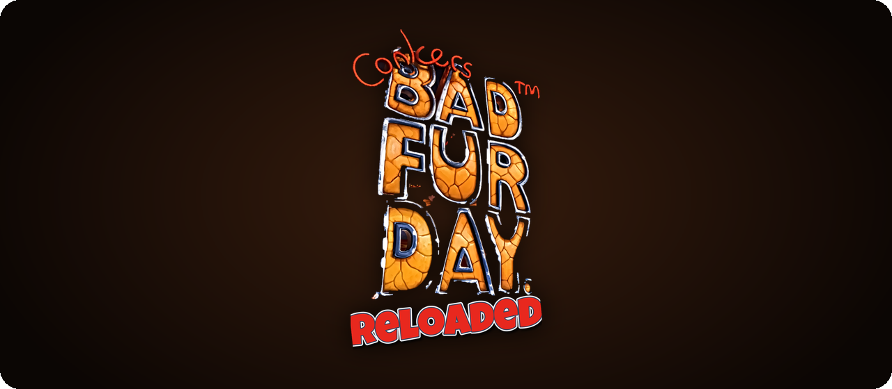

# Conker's Bad Fur Day: Reloaded

Conker's Bad Fur Day: Reloaded is a native PC port of Conker's Bad Fur Day for Windows and Linux. The N64
game is **statically recompiled** with [N64: Recompiled](https://github.com/N64Recomp/N64Recomp) and drawn
with [RT64](https://github.com/rt64/rt64), so it runs at full speed with widescreen, high frame rates and
mouse, keyboard and controller support. A **Classic** mode keeps it as close to the N64 as possible, and a
**Modern** mode turns on everything new.

### [Download the latest release here](../../releases/latest)

### **This repository and its releases do not contain game assets. You need your own US ROM of the game.**

## Table of Contents
* [Getting Started](#getting-started)
* [System Requirements](#system-requirements)
* [Features](#features)
  * [Classic or Modern](#classic-or-modern)
  * [Widescreen With No Black Bars](#widescreen-with-no-black-bars)
  * [High Frame Rate](#high-frame-rate)
  * [Free Camera](#free-camera)
  * [Twin-Stick Aiming](#twin-stick-aiming)
  * [Mouse, Keyboard and Gyro](#mouse-keyboard-and-gyro)
  * [Aiming Crosshair](#aiming-crosshair)
  * [Hold to Skip Cutscenes](#hold-to-skip-cutscenes)
  * [Quality of Life](#quality-of-life)
  * [Accessibility](#accessibility)
  * [Accurate Graphics](#accurate-graphics)
  * [Translations and ROM Hacks](#translations-and-rom-hacks)
  * [Mods and Texture Packs](#mods-and-texture-packs)
  * [Controllers and Multiplayer](#controllers-and-multiplayer)
  * [Linux and Steam Deck](#linux-and-steam-deck)
* [HD Icons Texture Pack](#hd-icons-texture-pack)
* [Playing in French](#playing-in-french)
* [FAQ](#faq)
* [Known Issues](#known-issues)
* [Building](#building)
* [Credits](#credits)
* [License](#license)

## Getting Started
1. Download the `Windows.zip` or the `Linux.tar.gz` from the [Releases](../../releases) page.
2. Unzip it anywhere and run `ConkerBFDReloaded` (`.exe` on Windows).
3. Pick your ROM the first time. It's remembered after that.
4. In the settings, go to the **Conker** tab and choose **Classic** or **Modern**.

The ROM is the US version: `Conker's Bad Fur Day (USA).z64`, SHA-1 `4cbadd3c4e0729dec46af64ad018050eada4f47a`.

## System Requirements
* **Windows:** Windows 10 or 11, 64-bit, and a graphics card with DirectX 12 or Vulkan.
* **Linux:** a 64-bit distro with glibc 2.35 or newer (Ubuntu 22.04+, Fedora 36+, Debian 12+), a Vulkan
  driver, and SDL2, GTK 3 and FreeType (most desktops have them already).

If the game crashes on startup, update your graphics drivers first.

## Features

#### Classic or Modern
One switch on the Conker tab. **Classic** is the N64: 4:3, 30 fps, the game's own camera, lighting and
controls, only at a higher resolution. **Modern** turns on widescreen, the display's frame rate, smooth
textures and shading, the free camera, twin-stick aiming, the crosshair, Skip Intro, Hold to Skip, Ledge Grab,
the Longer Tail Spin, the air meter and keyboard button prompts. Pick **Custom** to choose everything yourself.

#### Widescreen With No Black Bars
Gameplay, menus, the pause screen and the cutscenes fill the screen edge to edge. Where a shot was framed for
4:3, the camera is moved so nothing important gets cut off, and screen effects like the circle wipe and the
eyelids waking up in It's War reach the edges too.

#### High Frame Rate
Play at your display's refresh rate or at the original 30 fps. The game still runs its logic at 30 fps, so
Conker handles exactly as he always did.

#### Free Camera
Turn the camera with the right stick or the mouse, and it stays where you put it. It doesn't go through walls,
posts or the floor: it comes in where there's no room and glides back out, holds still next to moving objects,
and stays above ground that rises behind Conker. It tilts a little with slopes, and tilting down past Conker looks
up. Click the right stick to switch between near, middle and far, or use the mouse wheel.

#### Twin-Stick Aiming
* **Swap Sticks:** while aiming, the right stick aims and the left stick moves.
* **Move While Shooting:** with the shotgun, Conker keeps walking as he fires.
* **Face Where the Camera Looks:** pressing R aims the way the free camera looks, not the way Conker faces.
* **Lock-On** can be turned off if you'd rather aim yourself.

#### Mouse, Keyboard and Gyro
Mouse aiming and camera, gyro aiming on supported controllers, bindable mouse buttons, and button prompts in the
speech bubbles and menus that show your keys when you play with the keyboard.

#### Aiming Crosshair
A red dot in the middle of the screen when Conker aims a gun that shoots straight (the shotgun, the magnum), and
none for thrown things, which fly in an arc. The sniper scope keeps its own crosshair.

#### Hold to Skip Cutscenes
Hold L to skip any cutscene, even the first time and the ones the original never lets you skip. A ring fills
while you hold, so you can't skip by accident. **Skip Intro** goes straight to the bar menu.

#### Quality of Life
* An autosave icon in the corner while the game saves.
* **Show Cash:** your cash on screen, drawn like the pause screen's, when it changes or all the time.
* Separate Music, Sound Effects and Speech volumes.
* **Conker's Detail:** Conker stays on his most detailed model at any camera distance.
* Pause when you alt-tab.

#### Accessibility
Toggle instead of hold for R-Look and crouch, walk with L (hold or toggle), **Ledge Grab** (catch the edge when
you walk off something high or come up short on a jump), invert swimming, longer breath and an air meter
underwater, a longer tail spin, health always on screen, and turning off the motion blur and drunken sway.

#### Accurate Graphics
Lighting checked scene by scene against an accurate N64 emulator, the shiny reflections (the gold Rareware logo,
the bottles in the bar) restored, smooth menu pictures with no seams at high resolutions, and optional smooth
per-pixel shading.

#### Translations and ROM Hacks
ROM hacks that keep the game's code are accepted, like the uncensored speech and translations. **ROM** in the
launcher picks one and shows which you're playing: Original, Uncensored, French, German or Russian.

#### Mods and Texture Packs
RT64 texture packs (`.rtz`) and N64Recomp mods (`.nrm`) go in through the Mods menu and can be switched on and
off while you play.

#### Controllers and Multiplayer
Built-in support for N64 controllers and adapters (raphnet, Mayflash, Hyperkin, the Switch Online N64 controller,
the 8BitDo 64), rumble, and several controllers for multiplayer.

#### Linux and Steam Deck
A Linux build is in every release. On the Steam Deck, extract it in desktop mode, right-click
`ConkerBFDReloaded` and choose **Add to Steam**. Clicking the right stick zooms the free camera, since there's no
mouse wheel.

## HD Icons Texture Pack
An optional pack that makes the 2D pictures sharp: the HUD, the pause screen, menu buttons and titles, the bar's
signs and the chapter names. It's built from GameBeast92's 4K Ultimate Texture Pack, with the original game's
colours and shapes put back wherever that pack changed them.

Download `ConkerBFDReloaded-HD-Icons` (`.rtz`) from the [Releases](../../releases) page, then in the game go to
**Mods** > **Install Mods** and pick the file. Turn it off for the German translation, as it would cover the German
pictures with English ones.

Textures by [GameBeast92](https://github.com/GameBeast92/Conker-s-Bad-Fur-Day-4k-Ultimate-Texture-Pack), used and
modified under [CC BY 4.0](https://creativecommons.org/licenses/by/4.0/). The `LICENSE.txt` inside the pack lists
what was changed.

## Playing in French
The French translation by **Corrigo** (text) and **Djipi** (graphics) works here, with their permission.

1. Download their patch from [emulation64.fr](http://www.emulation64.fr/) and apply `ConkerFR1-3.bps` to your US
   ROM with a patcher such as [Rom Patcher JS](https://www.marcrobledo.com/RomPatcher.js/).
2. Pick the patched ROM with **ROM** in the launcher. It shows **ROM: French**.
3. For Djipi's French menus and titles, install the `ConkerBFDReloaded-HD-Icons-French` pack instead of HD Icons.

The German translation works the same way with the [ConkerDeutschMod](https://github.com/niehoff90/ConkerDeutschMod)
patch. No ROMs or patched ROMs are shared here.

## FAQ

#### What is static recompilation?
The N64 game's code is translated into a native PC program ahead of time, instead of being emulated while you play.
See [N64: Recompiled](https://github.com/N64Recomp/N64Recomp) for how it works.

#### Where are my saves and settings?
* Windows: `%LOCALAPPDATA%\ConkerBFDReloaded`
* Linux: `~/.config/ConkerBFDReloaded`

#### Can I use my emulator save?
Yes. An N64 EEPROM save (a `.eep` from Project64, for example) works as it is: copy it into the `saves` folder
as `conker.n64.us.1.0.bin`, after backing up the one that's there.

#### The ROM picker doesn't show up on Linux.
Start it once from a terminal with `./ConkerBFDReloaded --rom /path/to/conker.z64`. It's remembered after that.

## Known Issues
* The free camera stays out of the game's fixed-camera spots (some doorways, the Windy barn), on purpose.
* A low post or fence between the camera and Conker can still hide his body.
* Ledge Grab catches straight edges, not the tip of a corner, and can sometimes catch an edge that isn't really a
  ledge, like the slanted side of a staircase.
* Move While Shooting works with the shotgun only. While he walks and fires, his legs keep the shooting pose
  (the game has no walk-and-shoot animation).
* The HD Icons (French) pack is missing about 40 pictures that only show up at certain moments of the story.
* A few lines are still bleeped with the uncensored ROM: the bleeps are in the ROM hack itself.
* In Bat's Tower, after the third cog, Conker's lips don't move and the cog's line can be silent.
* Not tested everywhere yet: Linux on real hardware, frame rates above 60, rumble, gyro and multiplayer,
  Face Where the Camera Looks with the shotgun, and the German and Russian translations.
* No macOS build yet.

Found something else? Please [open an issue](../../issues) with what you were doing and a screenshot if you can.
Ideas go on the [Discussions](../../discussions) board.

## Building
You need the ROM in this folder as `conker.z64`, the [mkst/conker](https://github.com/mkst/conker) decompilation
(commit `3adf229`) built into `conker/`, and [N64Recomp](https://github.com/N64Recomp/N64Recomp) (commit `ffb39cd`,
with `patches/n64recomp.patch` then `patches/n64recomp_conker.patch` applied) built into `N64Recomp/`.

1. `tools/prepare_game.sh` prepares the game code for translation.
2. `tools/rebuild_all.sh --force` translates it into `recomp/out`. On Windows (with WSL for this step) it also builds
   `ConkerBFDReloaded.exe` with Visual Studio 2022, CMake and Ninja, after `host/setup_deps.bat`.
3. On Linux, `tools/setup_deps.sh` fetches and patches the dependencies, then `tools/build_linux.sh` builds it (GCC
   13+ or Clang, CMake, Ninja, and the SDL2, GTK 3, FreeType, X11 and Vulkan development packages).

| Folder     | What's in it |
|------------|--------------|
| `host/`    | The program: source in `src/`, menu art and fonts in `assets/`, Windows build scripts. |
| `recomp/`  | How the game gets translated: `conker.toml` (N64Recomp settings and hooks). |
| `patches/` | Changes to N64Recomp, N64ModernRuntime, RT64 and RecompFrontend. |
| `tools/`   | Build scripts, texture pack tools (`textures/`) and test tools (`testing/`). |

## Credits
Made by **dahmedvall95**, built on the work of:
* [CBFD-Recompiled](https://github.com/sciaschi/CBFD-Recompiled) by Sean Ciaschi (MIT, see
  `recomp/THIRD_PARTY_LICENSE`): mouse and gyro aiming, rumble, Swap Sticks, Lock-On, Conker's Detail, controller
  support and many fixes. Files taken from it say so at the top.
* [mkst/conker](https://github.com/mkst/conker), the Conker decompilation.
* [N64Recomp, N64ModernRuntime and RecompFrontend](https://github.com/N64Recomp) by Wiseguy and contributors.
* [RT64](https://github.com/rt64/rt64) by Darío and contributors, the renderer.
* [GameBeast92's 4K Ultimate Texture Pack](https://github.com/GameBeast92/Conker-s-Bad-Fur-Day-4k-Ultimate-Texture-Pack)
  (CC BY 4.0), behind the HD Icons pack.
* **Corrigo** and **Djipi** ([emulation64.fr](http://www.emulation64.fr/)) for the French translation, used with
  permission.
* The [Conker Wiki](https://conker.fandom.com/) for some of the N64 screenshots in the launcher's collage.
* GLideN64 and Rice Video, whose texture fingerprints match texture packs.
* Fonts: Inter, Noto Emoji, Luckiest Guy, Coming Soon, Poppins (SIL Open Font License) and PromptFont.

## License
The code in this repository is MIT (see `LICENSE`), and parts from other projects keep their own licenses, noted in
the files. The released program includes [N64ModernRuntime](https://github.com/N64Recomp/N64ModernRuntime) (GPL-3.0),
so it's distributed as a whole under the GPL-3.0. The release's `LICENSE` file has the details.

*Conker's Bad Fur Day* is © Rare / Microsoft. This is a fan project, not affiliated with or endorsed by them, and it
doesn't include any of the game's data.
